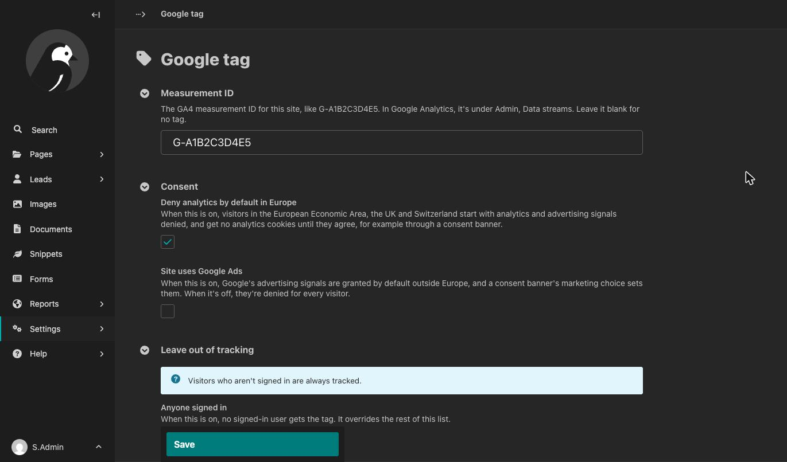

# Wagtail Google tag

Google tag configuration UI (GA4) for Wagtail. Our ultimate goal is everything you need to do to set up GA, you do through the Wagtail admin.

Claude Code was used with oversight by the maintainer.

## Summary of Purpose

“Wagtail Google tag” adds Google tags for Google Analytics 4 to a Wagtail site, exposing as much setup and configuration as possible via the admin UI and providing a clear checklist of what has to be done outside that. The focus is on sending data to GA.

It doesn't bring Google Analytics into the Wagtail admin: reports stay in Google Analytics, and so do its own settings, such as data retention and key events. It also doesn't load a Tag Manager container of your own.

## Progress so far
* A `page_view` for every page, sent by Google's tag
* Google Analytics' enhanced measurement (scrolls, outbound clicks and site search), per your setup in Google Analytics
* Tag is kept out of preview views automatically (non-configurable)
* Settings available under Settings → Google tag: see the [settings reference](https://github.com/Limitless-Horizons/wagtail-google-tag/blob/main/docs/reference/settings.md)
* In your templates, add an HTML attribute to a link or button to enable [click events](https://github.com/Limitless-Horizons/wagtail-google-tag/blob/main/docs/how-to/send-events.md).
* For visitors your site knows, a [User-ID](https://github.com/Limitless-Horizons/wagtail-google-tag/blob/main/docs/how-to/set-a-user-id.md) of your own on their events
* For a page whose address holds a secret, such as a signed download or unsubscribe link, an address of your choosing in Google Analytics: [Keep secrets out of page addresses](https://github.com/Limitless-Horizons/wagtail-google-tag/blob/main/docs/how-to/keep-secrets-out-of-page-addresses.md)



## Requirements

- Wagtail 7.4, 8.0 or 8.1, with the [Python and Django versions](https://docs.wagtail.org/en/stable/releases/upgrading.html#compatible-django-python-versions) each of them supports
- `wagtail.contrib.settings`, which comes with Wagtail
- `django.template.context_processors.request` in your template settings. Wagtail's project template has it. Without it, the tag loads nothing.

## Installation

1. Install the package:

   ```sh
   pip install wagtail-google-tag
   ```

2. Add it to `INSTALLED_APPS`, with `wagtail.contrib.settings`:

   ```python
   INSTALLED_APPS = [
       # ...
       "wagtail.contrib.settings",
       "wagtail_google_tag",
       # ...
   ]
   ```

3. Create its tables:

   ```sh
   python manage.py migrate
   ```

4. Add the tag near the top of `<head>` in your base template:

   ```django
   
   <!doctype html>
   <html>
     <head>
       <meta charset="utf-8">
       
       ...
   ```

5. In the Wagtail admin, go to **Settings → Google tag** and enter your GA4 measurement ID. In Google Analytics, it's under **Admin → Data streams**, in your web stream.

The tag's script is one of the package's static files. On a deployed site, run `collectstatic` after you install or upgrade the package, as for any app's static files.

Then follow [Getting started](https://github.com/Limitless-Horizons/wagtail-google-tag/blob/main/docs/tutorial/getting-started.md) to see your first visit and send your first event.

## Documentation

The [documentation](https://github.com/Limitless-Horizons/wagtail-google-tag/blob/main/docs/README.md) is in four parts:

- **Tutorial:** [Getting started](https://github.com/Limitless-Horizons/wagtail-google-tag/blob/main/docs/tutorial/getting-started.md).
- **How-to guides:** [set up Google Analytics](https://github.com/Limitless-Horizons/wagtail-google-tag/blob/main/docs/how-to/set-up-google-analytics.md), [send events](https://github.com/Limitless-Horizons/wagtail-google-tag/blob/main/docs/how-to/send-events.md), [connect a consent banner](https://github.com/Limitless-Horizons/wagtail-google-tag/blob/main/docs/how-to/connect-a-consent-banner.md), [set a User-ID](https://github.com/Limitless-Horizons/wagtail-google-tag/blob/main/docs/how-to/set-a-user-id.md), [keep secrets out of page addresses](https://github.com/Limitless-Horizons/wagtail-google-tag/blob/main/docs/how-to/keep-secrets-out-of-page-addresses.md), [add the tag to other templates](https://github.com/Limitless-Horizons/wagtail-google-tag/blob/main/docs/how-to/add-the-tag-to-other-templates.md), [allow the tag in a Content Security Policy](https://github.com/Limitless-Horizons/wagtail-google-tag/blob/main/docs/how-to/allow-the-tag-in-a-content-security-policy.md), and [test and troubleshoot](https://github.com/Limitless-Horizons/wagtail-google-tag/blob/main/docs/how-to/test-and-troubleshoot.md).
- **Reference:** [settings](https://github.com/Limitless-Horizons/wagtail-google-tag/blob/main/docs/reference/settings.md), the [template tag](https://github.com/Limitless-Horizons/wagtail-google-tag/blob/main/docs/reference/template-tag.md), the [script API](https://github.com/Limitless-Horizons/wagtail-google-tag/blob/main/docs/reference/script-api.md), and [HTML attributes and events](https://github.com/Limitless-Horizons/wagtail-google-tag/blob/main/docs/reference/html-attributes.md).
- **Explanation:** [consent](https://github.com/Limitless-Horizons/wagtail-google-tag/blob/main/docs/explanation/consent.md), [who is tracked](https://github.com/Limitless-Horizons/wagtail-google-tag/blob/main/docs/explanation/who-is-tracked.md), [page views](https://github.com/Limitless-Horizons/wagtail-google-tag/blob/main/docs/explanation/page-views.md), and [privacy](https://github.com/Limitless-Horizons/wagtail-google-tag/blob/main/docs/explanation/privacy.md).

## Links

- [Changelog](https://github.com/Limitless-Horizons/wagtail-google-tag/blob/main/CHANGELOG.md)
- [Contributing](https://github.com/Limitless-Horizons/wagtail-google-tag/blob/main/CONTRIBUTING.md)
- [Security policy](https://github.com/Limitless-Horizons/wagtail-google-tag/blob/main/SECURITY.md)
- [Agents](https://github.com/Limitless-Horizons/wagtail-google-tag/blob/main/AGENTS.md)

## License

BSD-3-Clause. See [LICENSE](https://github.com/Limitless-Horizons/wagtail-google-tag/blob/main/LICENSE).
