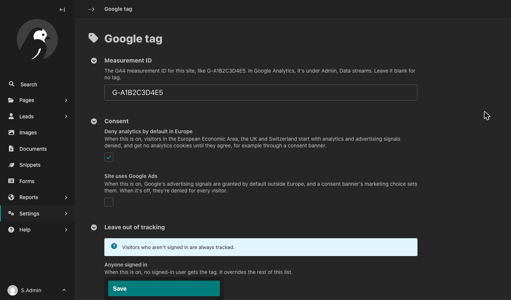

# Wagtail Google tag

Google tag configuration UI (GA4) for Wagtail. Our ultimate goal is everything you need to do to set up GA, you do through the Wagtail admin.

Claude Code was used with oversight by the maintainer.

## Summary of Purpose

“Wagtail Google tag” adds Google tags for Google Analytics 4 to a Wagtail site, exposing as much setup and configuration as possible via the admin UI and providing a clear checklist of what has to be done outside that. The focus is on sending data to GA.

It doesn't bring Google Analytics into the Wagtail admin: reports stay in Google Analytics, and so do its own settings, such as data retention and key events. It also doesn't load a Tag Manager container of your own.

## Progress so far
* A `page_view` for every page, sent by Google's tag
* Google Analytics' enhanced measurement (scrolls, outbound clicks and site search), per your setup in Google Analytics
* Tag is kept out of preview views automatically (non-configurable)
* Settings available under Settings → Google tag, per the table below
* In your templates, add an HTML attribute to a link or button to enable [click events](#click-events).
* For visitors your site knows, a [User-ID](#user-id) of your own on their events

## Settings reference

Each site has its own settings, under **Settings → Google tag**.



| Setting | Default | What it does |
|---|---|---|
| Measurement ID | Blank | The site's GA4 measurement ID (`G-…`). Blank means no tag. |
| Deny analytics by default in Europe | On | When on, visitors in Europe start with analytics and advertising signals denied, as in [Consent](#consent). When off, they start like everyone else. |
| Site uses Google Ads | Off | When on, advertising signals are granted by default outside Europe, and a banner's `marketing` choice sets them. When off, they're denied for every visitor. |
| Leave out of tracking | Nothing checked | Roles that will _not_ get a tag, as a list of checkboxes. See [Who is tracked](#who-is-tracked). |
| Track email and phone links | On | When on, a click on an email or phone link sends `contact_link_click` with `link_type` set to `email` or `phone`. |

### Who is tracked

Two settings decide this, and they do different jobs:

- **Leave out of tracking** decides whether a visitor gets Google's tag at all. A visitor with a checked role gets no tag, and nothing about their visit is sent. Use this to leave logged-in Editors untracked, for example.
- **Consent** decides what the tag may do for everyone else. A visitor who hasn't agreed to analytics, or has withdrawn, still gets the tag, but it sets no analytics cookies and sends Google only cookieless pings. See [Consent](#consent).

Neither overrides the other. Everyone gets the tag unless you check a role under **Leave out of tracking**:

| Checkbox | Who it leaves out |
|---|---|
| Anyone signed in | Every signed-in user. It overrides the rest of the list. |
| Administrators | Users with Wagtail's Administrator status |
| Signed in, with no group | Signed-in users who belong to no group |
| Each group, by name | Members of that group, such as Editors or Moderators |

A user with several roles is left out if any one of them is checked. Visitors who aren't signed in are always tracked. Groups are the ones under **Settings → Groups**, and a group you add there appears in the list.

## Requirements

- Wagtail 7.4, 8.0 or 8.1, with the [Python and Django versions](https://docs.wagtail.org/en/stable/releases/upgrading.html#compatible-django-python-versions) each of them supports
- `wagtail.contrib.settings`, which comes with Wagtail
- `django.template.context_processors.request` in your template settings. Wagtail's project template has it. Without it, the tag loads nothing.

## Installation

1. Install the package:

   ```sh
   pip install wagtail-google-tag
   ```

2. Add it to `INSTALLED_APPS`, with `wagtail.contrib.settings`:

   ```python
   INSTALLED_APPS = [
       # ...
       "wagtail.contrib.settings",
       "wagtail_google_tag",
       # ...
   ]
   ```

3. Create its tables:

   ```sh
   python manage.py migrate
   ```

4. Add the tag near the top of `<head>` in your base template:

   ```django
   
   <!doctype html>
   <html>
     <head>
       <meta charset="utf-8">
       
       ...
   ```

5. In the Wagtail admin, go to **Settings → Google tag** and enter your GA4 measurement ID. In Google Analytics, it's under **Admin → Data streams**, in your web stream.

The tag's script is one of the package's static files. On a deployed site, run `collectstatic` after you install or upgrade the package, as for any app's static files.

## Usage

### Click events

Add `data-google-tag-event` to any link or button to send that event when it's clicked. Add parameters as JSON in `data-google-tag-params`:

```html
<a href="/pricing/"
   data-google-tag-event="select_content"
   data-google-tag-params='{"content_type": "cta", "content_id": "pricing-hero"}'>
  See pricing
</a>
```

A click sends one event. An email or phone link with its own `data-google-tag-event` sends only that event, not `contact_link_click` as well.

### From scripts

The tag defines `window.wagtailGoogleTag`. It's there on every page, and sends nothing when the tag isn't loaded, so scripts never need to check:

```js
window.wagtailGoogleTag.track("generate_lead", { method: "newsletter" });
```

### User-ID

If your site knows who a visitor is, it can give Google Analytics its own ID for them, so that their visits are counted as one person's across sessions and devices. This is Google Analytics' [User-ID](https://support.google.com/analytics/answer/9213390) feature:

```js
window.wagtailGoogleTag.user("3f6c1a52-9d0e-4c7b-8a41-5e2b7d90c1aa");

// When the visitor is no longer known, or has asked you to stop
window.wagtailGoogleTag.user(null);
```

Call it on each page where you know the visitor, as early as you can. The ID goes on the events that follow, not on the page view Google's tag has already queued; Google Analytics connects a session's earlier events to the ID once it arrives.

The package doesn't decide who a visitor is or whether they've agreed: that's your site's job. Google's rules for the feature are yours to meet:

- **No personal information in the ID.** Use a random ID of your own, never an email address or a name, hashed or not. It can be 256 characters at most.
- **The visitor's consent to connecting their activity.** Google requires it before you join what a visitor did before and after you knew who they were. Agreeing to analytics cookies in a banner isn't that consent. Ask for it separately, in plain words.
- **Notice.** Say in your privacy notice that you use an identifier this way.

When a visitor refuses or withdraws analytics, the package clears the User-ID along with [Google Analytics' cookies](#consent). If they allow analytics again, call `user()` again.

### Templates outside your base template

A template that doesn't extend your base template, such as a 404 page, needs the tag too:

```django

...

```

### Page views

Google's tag sends the page view itself, with the page's address and title.

Google has deprecated the `config` command, and the tags of newer Google Analytics properties ignore it. So the package sends data only on events.

### Testing your setup

Visit your site, click around, and watch Google Analytics' **Realtime** report (**Reports → Realtime**). Google gives Realtime's delay as typically a few minutes, with no guarantee. Select an event there to see the parameters sent with it. If your own role is checked under **Leave out of tracking**, visit while signed out of Wagtail.

### Content Security Policy

If your site has a Content Security Policy, allow Google's tag in it. Google lists the sources Google Analytics needs in its [Content Security Policy guide](https://developers.google.com/tag-platform/security/guides/csp#google_analytics): `https://www.googletagmanager.com` for scripts, and more for images and connections. The package itself uses no inline scripts.

## Consent

Before a visitor has made a choice, Google's tag starts with these Consent Mode defaults:

| Visitors | Analytics | Advertising signals |
|---|---|---|
| In the European Economic Area, the UK and Switzerland | Denied | Denied |
| Everywhere else | Granted | Denied, unless "Site uses Google Ads" is on |

Google works out where a visitor is. Denied analytics means no analytics cookies: Google Analytics receives only cookieless pings, which Google says can't directly identify an individual, and uses them to model the data that's missing. To start with analytics granted everywhere, turn off **Deny analytics by default in Europe**.

This is what Google calls advanced consent mode: the tag loads for every visitor and adjusts to their consent, rather than staying off until they agree. It keeps the most measurement Consent Mode allows. A cookieless ping still reaches Google, so check that this fits the rules that apply to your site.

A consent banner updates these defaults with the visitor's choice, in either of two ways:

```js
// Call the function
window.wagtailGoogleTag.consent({ analytics: true, marketing: false });

// Or send this event on document
document.dispatchEvent(
  new CustomEvent("wagtail-cookie-consent:change", {
    detail: { analytics: true, marketing: false },
  }),
);
```

`analytics` sets analytics storage. `marketing` sets the advertising signals, and only when **Site uses Google Ads** is on. A banner that runs on each page load once a visitor has chosen should send the choice each time, as early as it can: Google's tag waits half a second for that update before it sends anything, and a choice that arrives later misses the page view.

When a visitor refuses or withdraws analytics, the package also deletes Google Analytics' cookies (`_ga` and those starting with `_ga_`), which Google's tag would otherwise leave in place, and clears the [User-ID](#user-id) if your site set one.

Google Analytics has two settings of its own that touch these defaults. They're in the property's Google tag settings, under **Admin → Data streams →** your stream **→ Configure tag settings**:

- **Override consent mode defaults:** leave it unset. If it's set, it replaces the defaults above.
- **Manage default consent settings:** choose "No. Do not automatically mark this data as consented."

The event comes from [wagtail-cookie-consent](https://github.com/Limitless-Horizons/wagtail-cookie-consent), a companion package, but any banner can send it or call the function. With that package, put `` before ``.

## Google Analytics setup checklist

These are set in Google Analytics, not in Wagtail. All of them are under **Admin** in your property.

1. **Data retention.** Under **Data collection and modification → Data retention**, choose how long Google Analytics keeps event data: 2 months, which is the default, or 14 months. Match what your privacy notice says.
2. **Enhanced measurement.** Under **Data collection and modification → Data streams →** your stream, check that **Enhanced measurement** is on. It's what sends scrolls, outbound clicks and site search. The search page in Wagtail's project template works as it is: its `?query=` is one of the parameters Google looks for.
3. **Key events.** Under **Data display → Events**, mark the events that count as results for you, such as `generate_lead`. An event appears there once Google Analytics has received it. To set one up before that, create the event there under its exact name, with **Create with code** and no default value.
4. **Custom dimensions.** A parameter on one of your events shows in reports only after you create a custom dimension for it. Under **Data display → Custom definitions**, create one with the scope **Event** for each parameter you want to report on. For the package's own event, that's `link_type` on `contact_link_click`. Type the parameter's name if the list doesn't offer it. A dimension fills in only from the day you create it.
5. **Google tag settings.** Under **Data collection and modification → Data streams →** your stream **→ Configure tag settings**:
   - **Allow user-provided data capabilities:** when it's on, Google's tag may look for email addresses on your pages. Turn it off if no email address should reach Google Analytics.
   - **Override consent mode defaults:** leave it unset, as in [Consent](#consent).
   - **Manage default consent settings:** choose "No. Do not automatically mark this data as consented."

   Some of these are behind **Show more**. If Google asks you to publish a new version, do: the settings don't apply until then.
6. **Reporting identity,** if your site sets a [User-ID](#user-id). Under **Data display → Reporting identity**, choose **Blended** or **Observed**: both use the User-ID. To follow one person, use the **User explorer** technique under **Explore**; it's also where you delete one person's data if they ask.
7. **Check that it works,** as in [Testing your setup](#testing-your-setup).

## Troubleshooting

- **No tag on the page:** the measurement ID is blank, your role is left out, the page is a preview, or `collectstatic` hasn't run. Run `python manage.py check` too: it warns when the request isn't in the template context.
- **Nothing in Realtime:** wait a few minutes, and turn off any ad blocker or tracking protection in your browser.
- **A parameter isn't in reports:** create a custom dimension for it (checklist item 4).
- **A Google tag setting has no effect:** publish the new version (checklist item 5).
- **Little data from Europe:** expected while analytics is denied by default. See [Consent](#consent).

## Privacy notes

The package sends no personal data. Email and phone link events carry only `link_type`, never the address or number. Google's own rules forbid personal data in Google Analytics, so keep it out of your own event parameters too.

## Links

- [Changelog](https://github.com/Limitless-Horizons/wagtail-google-tag/blob/main/CHANGELOG.md)
- [Contributing](https://github.com/Limitless-Horizons/wagtail-google-tag/blob/main/CONTRIBUTING.md)
- [Security policy](https://github.com/Limitless-Horizons/wagtail-google-tag/blob/main/SECURITY.md)
- [Agents](https://github.com/Limitless-Horizons/wagtail-google-tag/blob/main/AGENTS.md)

## License

BSD-3-Clause. See [LICENSE](https://github.com/Limitless-Horizons/wagtail-google-tag/blob/main/LICENSE).
