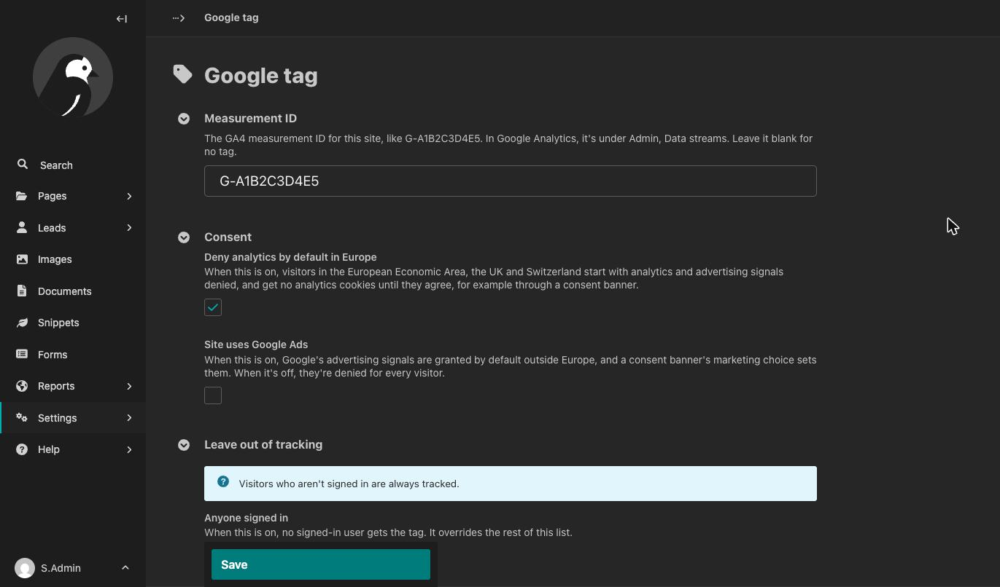

# Settings

Each site has its own settings, under **Settings → Google tag**.

| Setting | Default | What it does |
|---|---|---|
| Measurement ID | Blank | The site's GA4 measurement ID (`G-…`). Blank means no tag. |
| Deny analytics by default in Europe | On | When on, visitors in Europe start with analytics and advertising signals denied, as in [Consent](../explanation/consent.md). When off, they start like everyone else. |
| Site uses Google Ads | Off | When on, advertising signals are granted by default outside Europe, and a banner's `marketing` choice sets them. When off, they're denied for every visitor. |
| Leave out of tracking | Nothing checked | Roles that will _not_ get a tag, as a list of checkboxes. See [Who is tracked](../explanation/who-is-tracked.md). |
| Track email and phone links | On | When on, a click on an email or phone link sends `contact_link_click` with `link_type` set to `email` or `phone`. |

## Leave out of tracking

Everyone gets the tag unless you check a role under **Leave out of tracking**:

| Checkbox | Who it leaves out |
|---|---|
| Anyone signed in | Every signed-in user. It overrides the rest of the list. |
| Administrators | Users with Wagtail's Administrator status |
| Signed in, with no group | Signed-in users who belong to no group |
| Each group, by name | Members of that group, such as Editors or Moderators |

A user with several roles is left out if any one of them is checked. Visitors who aren't signed in are always tracked. Groups are the ones under **Settings → Groups**, and a group you add there appears in the list.

What this setting does, and how it differs from consent, is in [Who is tracked](../explanation/who-is-tracked.md).

## Permission

Wagtail registers one permission for this screen: change (`wagtail_google_tag.change_googletagsettings`). Give it to a group under **Settings → Groups**. A user without it doesn't see **Settings → Google tag**. Administrators always have it.
